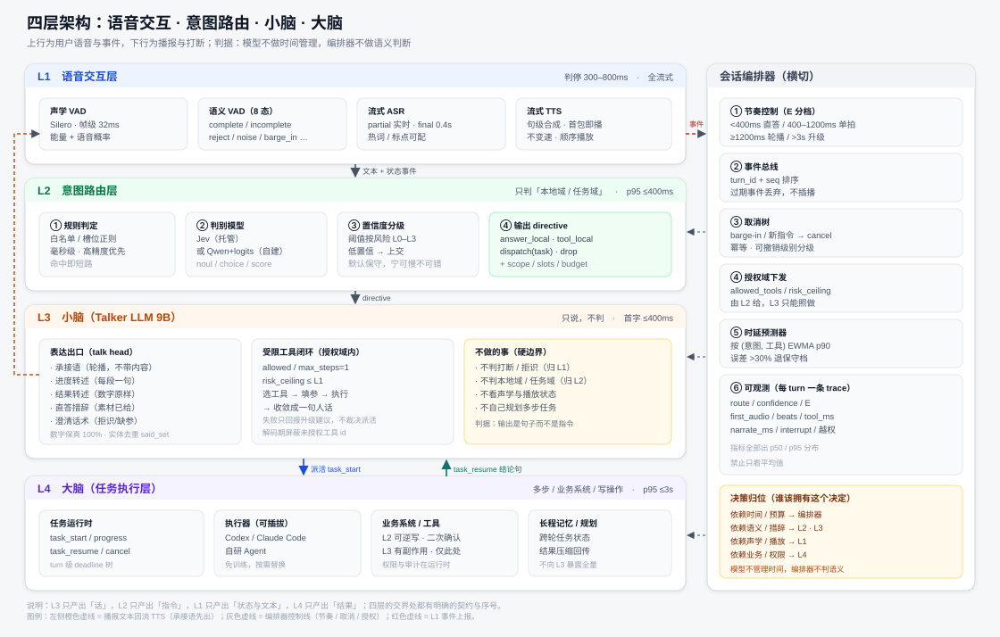

# 四层架构方案：语音交互 · 意图路由 · 小脑 · 大脑

> 版本 v0.2　·　2026-10-25　·　适用范围：级联全双工语音助手（Talker–Thinker 两级）
> 本版决策：L2 **规则先行、Jev 第二阶段**；L3 **选 8B 级（Qwen3.5-9B）**；L2 写操作走**口头确认**。
> 口径约定：文中标注【实测】的为项目内真实调用或代码级验证；标注【官方】的取自厂商或论文原文；
> 标注【估算】的为工程推算，须在 P0 阶段用实测替换。未标注来源的对比数字一律不进评审材料。

---

## 1. 方案总览

### 1.1 设计目标与约束

本方案要在**保持级联架构（ASR → LLM → TTS）不变**的前提下，引入一个像 Gander 那样"能跑任务闭环"的前端，
但不把交互控制训练进模型。目标与约束如下：

| 目标 | 量化表述 | 约束 |
|---|---|---|
| 低时延 | 说完→开始播 p50 ≤700ms、p95 ≤1200ms | 判停与 ASR 已占 ~700ms，路由与首字必须落在剩余预算内 |
| 不抢话 | 抢话率不高于当前基线 | 打断判定只能由 L1 的确定性事实驱动 |
| 能闭环 | 简单任务本地完成，复杂任务可上交 | 本地完成不等于本地裁决，裁决权在 L2 |
| 可解释 | 每个 turn 可回答"为什么走这条路" | 决策与台词分离，各自可单独评测 |
| 可迭代 | 换模型与开能力必须能分别验证 | 阶段划分必须单变量 |

三条不可让渡的约束：

1. **模型不做时间管理**：要不要先出承接语取决于预期等待时长，模型看不到时钟。
2. **编排器不做语义判断**：编排器只按规则与时延预算调度，不解释用户说了什么。
3. **确定性事实不进模型**：播放状态、是否插话、是否拒识由 L1 的规则与状态机产出（项目内已实测：模型会无视 prompt 中的确定性声明）。

### 1.2 四层职责与边界

| 层 | 名称 | 唯一职责 | 输入 | 输出 | 不做 |
|---|---|---|---|---|---|
| L1 | 语音交互 | 判断"要不要响应、是否打断、听没听清" | 音频流、播放状态 | 文本 + 状态事件 | 不做语义理解、不选模型 |
| L2 | 意图路由 | 判断"本地域 / 任务域" | 文本 + 会话槽位 | directive（指令） | 不生成话术、不挑具体工具 |
| L3 | 小脑（Talker LLM） | 把指令与素材变成"人话" | directive + material | 播报文本 + 受限工具调用 | 不判路由、不判打断、不规划多步 |
| L4 | 大脑 | 执行复杂任务并回传结果 | task_start | task_resume | 不直接对用户说话 |

**边界判据（用于评审时吵不清的场合）**

| 问题 | 判据 | 归属 |
|---|---|---|
| 要不要先出承接语 | 取决于预期等待时长 | 编排器（横切） |
| 这句话该谁答 | 取决于语义与风险等级 | L2 |
| 现在要不要停播 | 取决于声学与播放状态 | L1 |
| 这句怎么说 | 取决于措辞与素材 | L3 |
| 这个任务怎么做 | 取决于业务与权限 | L4 |

### 1.3 系统架构图



图中三条要点：

1. **往返路径**：L1 产出"文本 + 状态事件"，L3 产出"播报文本"回到 TTS——两条链路在编排器处对齐，不互相等待。
2. **派活与回传分离**：L3 → L4 只有 `task_start`，L4 → L3 只有 `task_resume`（结论句 + 关键字段），L3 永远拿不到全量中间状态。
3. **横切编排器**：节奏、事件序号、取消树、授权域、埋点都在这一列，四层里任何一层都不自行管理时间。

### 1.4 端到端时延预算

| 阶段 | 预算（ms） | 依据 | 归属 |
|---|---|---|---|
| 判停 | 300–800 | 项目实测 800ms 静音判停；语义 VAD 下可压到 300 | L1 |
| ASR final | 350–450 | 流式 fun-asr final ≈0.4s【实测】 | L1 |
| 路由判定 | ≤300 | 规则 <10ms；判别模型 p50 270–310ms【官方/独立】 | L2 |
| 承接语首字 | ≤600（从说完算） | 模板池预合成：选模板 + 播放启动 ≤150ms【估算】 | 编排器 |
| 模型生成句首字（转述/直答） | ≤900（从素材就绪算） | 9B 首 token 250–350 + TTS 首包 300–600【估算，须 P0 实测】 | L3 |
| 工具窗口 | 600–2100 | 决策 450（9B）+ 执行 timeout 1500 | L3 |
| 后台首句 | 800–3000 | 慢通道首 token ≈450ms，整句就绪 1–3s【实测】 | L4 |
| 强制升级 | >3000 | 超预算换长承接语 + 上报 | 编排器 |

**关键结论**：路由 300ms 不必挤进 150ms 预算——承接语可与路由并行合成，
只要承接语在路由完成前开始播，这 300ms 对用户不可感知。

### 1.5 五条设计原则

1. **指令与台词分离**：L2 输出指令、L3 输出句子；两者不共用一次模型调用。
2. **单变量迭代**：换模型、开工具、加转述必须分阶段验证（沿用《Talker直答与工具调用方案》的定级）。
3. **契约先行**：每层交界都有 schema 与序号，晚到事件一律丢弃而不是插播。
4. **宁可慢不可错**：误直答的代价远大于多等 1 秒，默认保守。
5. **可观测即功能**：每 turn 一条 trace，指标出分布不出平均值。

---

## 2. L1 语音交互层

### 2.1 组成与现状

| 模块 | 实现 | 关键参数 | 状态 |
|---|---|---|---|
| 声学 VAD | Silero（帧级 32ms） | 帧级门限 0.005 / 段级 0.012 | 已有 |
| 语义 VAD | 自研 10 态（原 8 态 + sidetalk / self_talk） | complete / incomplete / backchannel / reject / sidetalk / self_talk / noise / tts_echo / barge_in×2 | 已有（8 态）；sidetalk 待训 |
| 流式 ASR | fun-asr-realtime | partial 实时、final ≈0.4s | 已有 |
| 流式 TTS | qwen3-tts-realtime | 句级合成、首包即播、不变速 | 已有 |

### 2.2 事件契约

L1 对上层只暴露四类事件，禁止上层直接读音频状态：

| 事件 | 载荷 | 消费方 |
|---|---|---|
| `asr_final` | turn_id, text, ts | L2 |
| `vad_state` | state ∈ 8 态, confidence, ts | 编排器 → 决定 respond / wait / ignore / reject |
| `barge_in` | intentional / unintentional, ts | 编排器 → cancel 树 |
| `playback_state` | playing / idle, utterance_id | 编排器（不向 L3 暴露） |

### 2.3 指标

| 指标 | 目标 | 口径 |
|---|---|---|
| 判停延迟 | p50 ≤500ms / p95 ≤800ms | 最后语音帧 → asr_final |
| 误判停率（说一半被切） | <3% | 人工标注 200 段 |
| 打断响应 | ≤200ms 停播 | barge_in → 播放停止 |
| 拒识召回 | ≥90% | 自建拒识集（外部基准无覆盖） |

---

## 3. L2 意图路由层

### 3.1 职责与边界

L2 只回答一个问题：**这一轮该本地处理，还是该交给大脑**。它输出的是指令，不是话，也不是具体工具。

| 输出 action | 含义 | 附带字段 |
|---|---|---|
| `answer_local` | 素材已在本地可得（记忆检索 / FAQ / 纯格式化） | material |
| `tool_local` | 本地域内的只读或可逆写工具 | tool_grant（allowed / max_steps / risk_ceiling） |
| `dispatch` | 交给 L4 执行 | task_spec（意图 / slots / 预算 / 是否可取消） |
| `drop` | 附和、噪声、回声 | reason |

**与 L3 的分工**：L2 决定"授权哪些工具"，L3 决定"用哪个、参数填什么"。
判据：新增一个工具时改的是授权表一行，还是改 L2 的判定逻辑？后者说明路由正在回流，必须纠正。

### 3.2 可计算判据

| 判据 | 条件 | 结论 |
|---|---|---|
| 本地可解 | 无需外部信息 ∧ 单轮可解 ∧ 答案 ≤30 字 ∧ 无副作用 | `answer_local` |
| 本地工具 | 命中白名单 ∧ 参数单层 ∧ 预计 <1.5s ∧ 风险 ≤L1 | `tool_local` |
| 必须上交 | 步数 >1 ∨ 需业务系统 ∨ 命中 L3 风险 ∨ 置信度低于阈值 | `dispatch` |
| 丢弃 | 附和词 / 噪声转写 / 回声 | `drop` |

**风险分级（全方案唯一标准）**

| 级 | 例子 | 允许 L3 本地执行 | 处理 |
|---|---|---|---|
| L0 | 时间、单位换算、日期推算 | 是 | 无需确认 |
| L1 | 天气、查询类只读工具 | 是 | 带 timeout，失败即降级 |
| L2 | 设提醒、开关灯（可逆） | 是 | 播报确认 → 用户确认后执行 |
| L3 | 下单、支付、门锁 | 否 | 一律归 L4 |

判据一句话：**做错了能不能一句话撤回**。不能 → L4。

### 3.3 三级判定链路

```
asr_final
  ├─① 规则层（毫秒级）
  │    白名单 / 槽位正则 / 长度与语气词 / 已确认任务续接
  │    命中 → 直接出 directive（覆盖约 40–60% 的高频请求【估算，须用日志统计替换】，目标是"确定的不犹豫"）
  ├─② 判别模型层（p50 270–310ms）
  │    Jev（托管）或 自建 Qwen + logits 约束
  │    一次请求并行问多个原子问题，代码组合
  └─③ 兜底层
       模型超时 / 低置信 / 解析异常 → 默认 dispatch（宁可慢不可错）
```

三层是**串联短路**，不是投票：规则命中就不问模型；模型失联就走保守兜底。
这条设计直接复用项目里"高能力组件失败 → 回退低能力规则"的教训：
回退路径必须有保守默认，且要打 `degraded` 标记，否则误判面会放大。

### 3.4 判别模型选型：Jev 路线

**定位：第二阶段增强，不是前置依赖。** 本项目先上规则层（见 3.11），Jev 只用于补齐规则覆盖不到的长尾与边界判断；
规则层的降级路径必须始终可独立运行。

**能力与形态【官方】**

| 项 | 事实 | 出处 |
|---|---|---|
| 定位 | System One 判别模型，不生成文本 | TypeSafe 官方 blog（2026-09-15） |
| 接口 | `state`（string / JSON / array）+ typed `questions` → 概率分布 + confidence | 官方 docs |
| 问题类型 | noul（true/false）、choice（无序选项）、score（有序等级） | 官方 docs |
| 并行性 | 同一请求内所有问题并行且**相互独立**（有依赖必须发两次） | 官方 docs |
| 规模限制 | 64k token/请求、32k/单问题；选项基数上限 255 | 官方 docs / blog |
| 价格 | $0.042 / M input，output 免费 | 官方 models 页 |
| 版本 | jev-1.13.0 / jev-1.14.0（2026-10-14 起） | 官方 models 页 |

**独立评测（非厂商口径）**

| 来源 | 结论 | 对本方案的含义 |
|---|---|---|
| arXiv:2609.34024（医学，2026-09-27） | PubMedQA 78.4 vs GPT-6 Sol 78.2；MetaMedQA 74.8 vs 82.7；复杂诊断 59.8 vs 82.4；ECE 0.063（最佳）；p≥0.9 时准确率 93.4%；中位延迟 0.27–0.31s | 判别类任务够用；**不要用它做需要推理的判定** |
| Cisco 内容安全对比（2026-10） | 零样本 Jev ≈ 31B LLM judge（8 个基准 7 个 AUC 更高）；但专门微调的 1B encoder 在 0.5% 误报下全面胜出 | 领域内微调仍优于零样本；路由类任务建议自建兜底 |
| JevOut（NeurIPS 2026 Agenthon） | 在 state 中加入约 31 个"自然背景词"，可把 61.4%–73.2% 原本正确的决策翻成预先指定的错误选项，且保持高置信 | **路由输入必须做注入隔离**，高风险动作需二次校验 |

**落地约束（决定能不能用）**

| 约束 | 事实 | 影响 |
|---|---|---|
| 部署 | 仅托管 API，无权重、无 on-prem 文档，数据在美国西海岸处理 | 公司内网项目无法直连；需要私有化替代 |
| 许可 | proprietary | 无法蒸馏成自有模型对外交付 |
| 语言 | 官方未列语言支持；Cisco 在 ChineseSafe 上 Jev 领先（间接证据） | 中文可用性需自测，不能假设 |

**结论**：Jev 适合做 **PoC 与精度上限参照**，不适合作为内网产品的唯一判别器。

### 3.5 判别模型选型：自建路线

| 候选 | 基座 | 形态 | 可用性 | 备注 |
|---|---|---|---|---|
| Microsoft-Decision-1 | Qwen3.5-9B | 托管 | 36 项基准 83.5%，宣称比 Jev 快 2.8x，$0.042/M【官方】 | 同为境外服务 |
| H2O-Lightning-4B | Qwen3.5-4B | 开源权重 | 可自托管 | 与本地 4B 部署栈一致 |
| Strands Decider 2B | 未披露 | 开源 | 轻量 | 规模小，适合二分类 |
| OpenSourceJev | Qwen3-1.7B / Qwen3.5-4B | MIT，llama.cpp | 零训练 logits 投影 | JevBench 开源榜 capability 48.6（#57/92），需领域微调 |
| 自研 logits 判别器 | Qwen3.5-4B | 自研 | 完全可控 | **推荐作为内网主路径** |

**自建的核心技巧（比"换成大模型"更有效）**

1. **logits 投影代替自由生成**：共享前缀 → 取 next-token logits → 只在候选集上 softmax → 类型化决策。
   好处：零 JSON 语法错误、延迟低、可给概率。
2. **候选集在解码期屏蔽**：未授权选项不参与 softmax，等价于"物理上不可能输出错工具"。
3. **校准要自己做**：官方明确不对客户数据微调；自建后必须重新标定阈值（ECE + 选择性预测曲线）。

### 3.6 置信度与阈值分级

| 置信区间 | 含义 | 动作 |
|---|---|---|
| 高（conf ≥0.9 且 p≥0.9） | 明确 | 自动执行（仅 L0/L1） |
| 中（0.6–0.9） | 有倾向 | L2 写操作必须先确认；否则上交 |
| 低（<0.6） | 无把握 | 一律 `dispatch`，不硬答 |

阈值不设单一数字，按动作后果分级：

| 动作 | 阈值 | 理由 |
|---|---|---|
| L0 本地格式化 | 0.6 | 错了也就是多说一句 |
| L1 只读工具 | 0.8 | 错了会答非所问 |
| L2 可逆写 | 0.9 + 口头确认（流程见 3.10） | 错了要撤回 |
| L3 有副作用 | 不适用 | 不走模型判定，直接归 L4 |

### 3.7 鲁棒性与注入防护

JevOut 的结论（31 个词可翻转 61.4%–73.2% 的决策）对路由是致命问题，因为路由的 state 里必然包含用户原话。
三条硬措施：

1. **结构隔离**：`state` 用 JSON 字段承载（`{"user_text": "...", "slots": {...}}`），用户内容只出现在被引用的字段里，
   题目模板固定，不允许用户文本改写问题本身。
2. **问题原子化**：每题只问一件事（"这句是否在请求外部信息"），不把多个因素塞进一题——单题被带偏的影响面更小。
3. **高风险二次校验**：L2 及以上动作，第二跳用另一组问题交叉验证；两跳不一致 → `dispatch`。

### 3.8 输出契约

| 字段 | 类型 | 必填 | 说明 |
|---|---|---|---|
| `turn_id` | string | 是 | 一次用户输入一个 turn |
| `action` | enum | 是 | answer_local / tool_local / dispatch / drop |
| `confidence` | float | 是 | 0–1，最终决策的置信度 |
| `route_source` | enum | 是 | rule / model / fallback（用于归因） |
| `material` | object | 否 | answer_local 时给结论句、要点、关键数字 |
| `tool_grant` | object | 否 | allowed / max_steps / risk_ceiling / per_tool_timeout_ms |
| `task_spec` | object | 否 | 意图、slots、预算、可取消级别 |
| `budget_ms` | int | 是 | 本 turn 的剩余预算，编排器据此分档 |
| `degraded` | bool | 是 | 是否走过降级路径 |

### 3.9 评测方案

| 指标 | 定义 | 目标 |
|---|---|---|
| 路由准确率 | 与人工标注一致 | ≥95% |
| 误直答率 | 该上交却本地答了 | <1% |
| 误派活率 | 本可本地处理却上交 | <20%（体验指标，可放宽） |
| 选择性预测 | p≥0.9 时的准确率（coverage-accuracy） | ≥95%，且覆盖 ≥60% |
| 路由时延 | p50 / p95 | ≤300ms / ≤400ms |
| 注入鲁棒性 | 加干扰后翻转率 | <10% |

**评测集构造**：300–500 条真实语音转写，分层抽样：

| 分层 | 占比 | 用途 |
|---|---|---|
| 常规指令 | 40% | 主指标 |
| 近邻易混（同一问法不同对象） | 20% | 检验槽位与指代 |
| 需要多步/业务系统 | 15% | 检验上交判断 |
| 附和/噪声/回声 | 15% | 检验 drop |
| 拒识与残缺句 | 10% | 检验澄清触发 |

### 3.10 写操作的口头确认流程

适用：L2 可逆写（设提醒、开关灯、调温度）。L3 有副作用一律不走本流程（归 L4）。

| 步 | 动作 | 归属 |
|---|---|---|
| 1 | 判定 tool_local 且 risk=L2 → 不执行，下发 clarify 指令 | L2 |
| 2 | 播确认问句，必须复述关键参数（"明早七点提醒带伞，对吗"） | L3 |
| 3 | 用户口头应答 → 语义 VAD 判状态 + ASR 出文本 | L1 |
| 4 | 判定确认意图：明确肯定 → 执行；明确否定 → 取消；不确定 → 重问一次 | L2 |
| 5 | 执行后播回执（"设好了"） | L3 |
| 6 | 8s 无应答 → 作废，播"那这次先不设了" | 编排器 |

四条硬规则：

| 规则 | 理由 |
|---|---|
| 只接受明确肯定词表（是/对/好/可以/没问题/嗯对） | "嗯"可能是 backchannel；项目实测单字歧义模型判不准（"什么？"被判成 backchannel） |
| 确认问句必须复述关键参数 | 用户改主意时能当场发现 |
| 只重问一次 | 防死循环与话痨 |
| 确认期内出现噪声/残句/未判停 → 视为未确认 | 宁可作废，不可误执行 |

应答词表（初版，须用真实录音扩充）：

| 类别 | 示例 | 处理 |
|---|---|---|
| 肯定 | 是、对、好、可以、没问题、嗯对 | 执行 |
| 否定 | 不用、算了、不是、取消 | 取消并播"好的，已取消" |
| 歧义 | 嗯、啊、嗯？ | 重问一次（仅一次） |
| 无关 | 别的话/背景人声 | 视为未确认，超时作废 |

审计要求：每次确认都要落一条记录（ASR 文本、VAD 状态、判定结果、是否执行），
用于事后复盘误确认。

### 3.11 分阶段落地

| 阶段 | 内容 | 出口条件 |
|---|---|---|
| P0 | 规则层 + 埋点 | 规则覆盖率 ≥40%，误判可归因 |
| P1 | 口头确认流 + 写操作白名单 | 误确认 0，超时作废正确 |
| P2 | Jev 判别接入（第二阶段，非前置依赖） | 路由准确率 ≥95%，p95 ≤400ms |
| P3 | 置信度阈值标定 | 误直答率 <1%，选择性预测达标 |
| P4 | 注入鲁棒性加固 | 翻转率 <10% |
| P5 | 授权域下发（与 L3 联动） | 越权调用 0 |

**规则先行是刻意的**：Jev 是境外托管服务（数据在美国西海岸处理、无权重），
内网不可用时产品必须能只靠规则跑通。因此 Jev 上线只承担"提升覆盖率与边界判断"，
不承担"唯一依赖"——规则层的降级路径永远保留。

---

## 4. L3 小脑（Talker LLM）

### 4.1 职责与产出

L3 是"嘴"，不是"脑"。它只接受指令与素材，产出播报文本或受限工具调用。

| 产出 | 触发指令 | 典型长度 | 硬约束 |
|---|---|---|---|
| 承接语 | `beat=fill` | 8–15 字 | 不出现素材外信息、不承诺结果 |
| 进度转述 | `beat=progress` | ≤20 字/段 | 只描述范围与下一步 |
| 结果转述 | `beat=narrate` | 首句 ≤15 字 | 数字与专名原样、去重、不加评价 |
| 直答措辞 | `action=answer_local` | ≤30 字 | 只能用 material 里的事实 |
| 澄清话术 | `action=clarify` | ≤15 字 | 2–3 个变体轮换 |
| 受限工具调用 | `action=tool_local` + grant | — | 只能选 allowed 内的工具，单步 |

### 4.2 模型选型

#### 4.2.1 能力需求到规模的判据

| 能力 | 门槛 | 结论 |
|---|---|---|
| 承接语 / 转述 / 措辞 | 低（改写类） | 1.5–4B 足够 |
| 受限工具调用 | 高（指令遵循 + 严格 JSON + 参数抽取） | 9B 直接可用；4B 必须约束解码且仍可能漏参【项目实测结论】 |
| 多步规划 | 很高 | 不放 L3，归 L4 |

#### 4.2.2 基座候选

| 候选 | 参数 | 优势 | 风险 | 结论 |
|---|---|---|---|---|
| Qwen3.5-9B（AWQ 4bit） | 9B | 工具调用可靠、少写规则、口语更好；原生 262k 上下文 | 首 token +100–150ms、AWQ ≈6GB【估算】 | **默认基线（2026-10-25 决策）** |
| Qwen3.5-4B | 4B | 首字最快、显存小 | 工具需严格约束解码，仍可能漏参 | 备选：首字预算吃紧时 |
| 现有 qwen9.30（4B 微调版） | 4B | 已有业务语料适配 | 原为"直答+工具"训练，需重新对齐 L3 职责 | 仅作对照 / 初始化对照 |
| Qwen3.5-0.8B | 0.8B | 极快 | 转述易失真、口语生硬 | 仅用于承接语专用小模型（双模型方案） |

选型结论：**Qwen3.5-9B（8B 级）单模型为主路径**（用户 2026-10-25 决策），工具调用不再依赖"规则兜底 + 约束解码硬撑"；
4B 保留为**首字预算吃紧时的降级方案**，切换必须按单变量原则单独验证，不得与开工具同时进行。
代价是首字 +100–150ms，由承接语覆盖（见 4.7.2 的 E 分档）。

#### 4.2.3 部署形态与资源

| 项 | 9B 主路径 | 4B 备选 | 口径 |
|---|---|---|---|
| 权重精度 | AWQ 4bit ≈6GB / FP8 ≈9–10GB / BF16 ≈18GB | BF16 ≈8GB / AWQ 4bit ≈3GB | 【估算】 |
| 推理引擎 | vLLM + `--enable-auto-tool-choice --tool-call-parser --guided-decoding-backend xgrammar` | 同左（工具分支必须开约束） | 官方文档 |
| 首 token | 200–300ms（建议 P0 实测，含 4k 上下文） | 100–200ms | 【估算，须 P0 实测】 |
| 单卡并发 | 24G + AWQ：约 3–6 并发（4k 上下文） | 24G：约 4–8 并发 | 【估算】 |
| 上下文 | 原生 262k（转述/长任务友好），但长上下文会抬高首 token | 32k 级 | 官方模型卡 / 估算 |
| 结构化输出 | 推荐开（防越权工具），非必需 | **必须开**（工具 id / 参数枚举候选集屏蔽） | 见 4.2.4 |

**部署陷阱（项目已踩）**：vLLM 的 tool-call-parser 与模型 chat template 不匹配时工具会**完全不可用**，
P1 前必须用 5 条固定 query 单测 parser 往返。

#### 4.2.4 结构化输出策略

三层防线，从便宜到贵：

1. **模板 + 候选集**：工具 id 只在 allowed 集合上 softmax（解码期物理屏蔽）。
2. **JSON schema 约束**：参数枚举走 XGrammar，格式错误率归零。
3. **后置校验**：参数类型/范围校验失败 → 走澄清话术，不重试超过一次。

### 4.3 训练必要性判断

判据：**这个能力的失败能否被模板/规则/约束解码兜住？**

| 能力 | 只靠 prompt | 建议 | 数据量 |
|---|---|---|---|
| 承接语 | 70–80%（模板池可跑，但会越界） | 模板池为主 + 轻训变体 | 800–1,500 条 |
| 转述 | ≈60%（复读、加评价、改数字） | **必须训** | 2,000–5,000 条 |
| 直答措辞 | 80%+（素材已给） | 可选 | 500–1,000 条 |
| 工具调用 | 9B 明显好于 4B，但仍会漏参 | **必须训**（9B 可取下限） | 2,000–3,000 条 |
| 澄清话术 | 90%（模板足够） | 不训 | 3–5 个变体 |

9B 相对 4B 的实际差别：工具调用从"必须靠规则兜底"变成"训练 + 约束即可稳"，
因此 P3 阶段可以删掉一批补偿性规则（城市白名单这类），但**防御不松**：
L3 风险工具、schema 校验、确认流一个都不能删。

### 4.4 训练数据方案

#### 4.4.1 五类数据与配比

| 数据类 | 条数 | 来源 | 目的 |
|---|---|---|---|
| 承接语 | 1,200 | 模板 + 强模型扩写 | 学会"只说状态不说内容"、轮播不重复 |
| 进度转述 | 600 | 真实后台片段 + 改写 | 学会每段一句、不剧透未到的部分 |
| 结果转述 | 2,400 | 真实后台输出 + 人工改写 | 数字保真、去重、压成口语 |
| 直答措辞 | 800 | FAQ/记忆命中样本 | 统一口语风格、控制长度 |
| 工具调用 | 3,000 | 按授权域工具逐个人工构造 | 参数抽取、缺参反问、空结果 |
| 负例（越界/不该说） | 500 | 人工构造 | 抑制"自创内容"与"话痨" |
| 合计 | 8,000–8,500 | — | 混训集约 0.5–0.7M token【估算】；9B 基座取下限 |

#### 4.4.2 承接语数据规范

每条样本必须满足：

1. 不含指令中的具体内容（不出现"正在为您打开客厅灯"这类执行描述）。
2. 不承诺结果（不出现"马上就好""一定能查到"）。
3. 长度 8–15 字；实测 14 字≈3s，与慢通道首句就绪时间匹配。
4. 同组建 3–5 个等价变体，标注 `beat`，避免每轮同一句。

#### 4.4.3 转述数据规范

| 规则 | 说明 | 反例 |
|---|---|---|
| 数字原样 | 不改写、不换算、不四舍五入 | 3,200 元 → "三千多" |
| 实体原样 | 专名不翻译、不缩写 | "Qwen3.5-4B" → "千问" |
| 去重 | 同一实体/结论只说一次 | 连续两句都说"三个城市" |
| 不加评价 | 不出现"很不错/不太理想" | 转述阶段做判断 |
| 增量 | 每段一句，带 forward-only 语义 | 每段都把前文重念一遍 |

#### 4.4.4 工具调用数据规范

每工具 300–800 条，覆盖五类：

| 类型 | 占比 | 例子 |
|---|---|---|
| 参数完整 | 50% | "明天早上七点提醒我带伞" |
| 缺参需反问 | 15% | "设个提醒" → 反问几点 |
| 参数歧义 | 15% | 同名城市、同名设备 |
| 空结果 | 10% | 查询无命中 |
| 越界请求 | 10% | 要求两步 / 要求写操作 → 输出升级建议 |

#### 4.4.5 负例与越界样本

负例是这批数据里最值钱的部分，直接决定"话痨率"和"越界率"：

| 负例类型 | 构造方式 | 期望行为 |
|---|---|---|
| 素材不足 | 只给结论句，问细节 | 说"这个我没拿到"，不编 |
| 不该承接 | 等待 <400ms 的场景 | 直接答，不出承接语 |
| backchannel | 用户"嗯/对" | 不出声（本层不产生输出） |
| 重复播报 | 同 turn 第二拍 | 换变体或跳过 |
| 噪声转写 | 电视/背景人声 | 由 L2 drop，L3 不接单 |

#### 4.4.6 数据量计算

统计下限（每类）：

```
n ≥ z² · p(1−p) / e²        z=1.96, p=0.9
   e=±10% → n≈35（仅冒烟）
   e=±5%  → n≈138
   e=±3%  → n≈384
```

工程公式：

```
N_total = Σ_t ( K_t × n_min × f_scene × f_neg ) × f_aug

K_t      该类别的子类数（意图数 / 工具数 / 转述形态数）
n_min    每子类下限（推荐 200）
f_scene  信道系数：文本 1.0 / 语音转写 2.0–3.0 / 远场噪声 3.0–5.0
f_neg    难负例系数：1.0（不做）～2.0（1:1 近邻负例）
f_aug    合成折算：合成:真实=1:1 时取 0.6–0.8
```

代入本方案：工具 5 个 × 200 × 2.5（语音）× 1.5（近邻负例）= 3,750 条 【估算】→ 9B 基座收敛更快，
取 2,000–3,000；转述 4 种形态 × 200 × 3.0 = 2,400；承接语 4 类 × 200 × 1.5 = 1,200。
合计约 8,000 条（9B 取下限）。实际数量以 P2 的单能力饱和实验为准，不用公式硬凑。

数据规模的两条外部参照：

- 只学格式/风格，**500–2,000 条**即可（LIMA 用 1,000 条做出可用对齐【论文】）。
- 数据"选得对"可抵 3–4.5 倍数据量（GRAPE：1/3 数据 + 半 epochs 超过 Tulu3-SFT 3.5%【论文】）。
- 重复训练的上限：同一份数据重复 ≤4 个 epoch ≈ 新数据（Muennighoff et al., arXiv:2305.16264【论文】）。

#### 4.4.7 数据质检

| 检查项 | 方法 | 门槛 |
|---|---|---|
| 素材可追溯 | 每条答案的关键事实必须能在 material 找到 | 100% |
| 长度合规 | 脚本统计字符数分布 | 承接语 8–15 字占 ≥90% |
| 重复度 | 句级 simhash 去重 | 重复率 <5% |
| 语言一致性 | 中文（术语可保留英文） | 抽检 10% |
| 无决策标签 | 扫描是否混入"派活/路由"类标签 | 0 条 |

### 4.5 训练方案

#### 4.5.1 方式与超参

| 项 | 取值 | 理由 |
|---|---|---|
| 方式 | LoRA（数据稀缺时优于全参） | Bohnet 2025：LoRA 在技能获取与遗忘之间最优【论文】 |
| r / alpha / dropout | 32 / 64 / 0.1 | 沿用项目语义 VAD 增训的稳定配置 |
| 学习率 / warmup | 1e-4 / 200 步 | 同上 |
| epoch | 2–3（上限 4） | 超过 4 收益趋零且易背答案 |
| 序列长度 / packing | 4096 / 开启 | 转述样本长短混合 |
| 精度 | BF16（GPU）/ FP16（Mac 仅小样） | MPS bf16 不完整 |
| 单卡时长 | 24G 单卡约 1.5–3h【估算】 | 须实测替换 |

#### 4.5.2 训练-推理一致性

| 项 | 训练 | 推理 | 必须对齐 |
|---|---|---|---|
| chat template | 与基座一致 | vLLM 同模板 | 否则工具解析全错 |
| stop token | 句末 | 同 | 否则多吐半句 |
| 系统提示 | 固定的 L3 角色与硬约束 | 同字符串 | 否则行为漂移 |
| 解码配置 | 自由生成 | 工具分支走约束解码 | 两条通道分开配 |

#### 4.5.3 防遗忘与回归门槛

| 检查 | 门槛 | 方法 |
|---|---|---|
| 通用口语能力 | 不退化 >2 分 | 保留 200 条通用口语评测 |
| 工具调用参数准确率 | ≥97% | 专项集 |
| 越界率 | <2% | 负例集 |
| 数字保真 | 100% | 转述专项集 |
| 首字延迟 | 不劣于基线 10% | 在线采样 |

任一门槛不达标：回退到上一版 LoRA，并先修数据而不是调超参。

#### 4.5.4 迭代路径

```
L0 不训（prompt + 模板 + 约束解码）→ 拿四个基线数
L1 单能力 LoRA（先承接语，再转述）→ 每次只训一个行为，可归因
L2 混训（工具 + 转述 + 风格）→ 只在"少一次部署"有价值时做
```

### 4.6 评测体系

本节只定义"要测什么、目标值多少"。**用哪些集、怎么合成一个选型结论**见配套文档《L3模型选型评测方法》
（六轴十四集组合、z-score 归一化、硬门槛、冲突裁决、防污染）。

#### 4.6.1 离线评测集

| 分层 | 条数 | 来源 | 用途 |
|---|---|---|---|
| 常规短问答 | 150 | 真实语音转写 | 主指标 |
| 长任务（触发派活） | 100 | 真实 + 构造 | 承接/转述 |
| 工具调用 | 100 | 构造 + 真实 | 参数准确率 |
| 拒识/噪声/回声 | 60 | 自建 | 澄清与静默 |
| 边界（近邻易混） | 90 | 构造 | 越界与指代 |

共 500 条，人工标注"期望行为"（不是期望文本），评行为不评字面。

#### 4.6.2 指标与目标值

| 组 | 指标 | 目标 |
|---|---|---|
| 时延 | 首字延迟（首个音频包） | p50 ≤600ms / p95 ≤900ms |
| 时延 | 响应延迟（说完→开始播） | p50 ≤700ms / p95 ≤1200ms |
| 节奏 | 无空洞率（无 >200ms 静默） | ≥95% |
| 节奏 | 话痨率（不必要 fill） | ≤10% |
| 质量 | 承接语越界率 | <2% |
| 质量 | 转述数字保真 | 100% |
| 质量 | 重复播报率 | <5% |
| 闭环 | 工具参数准确率 | ≥97% |
| 闭环 | 空结果处理正确率 | ≥95% |
| 安全 | 越权工具调用 / L3 风险触碰 | 0 / 0 |

#### 4.6.3 在线 A/B 与归因

| 方法 | 做法 | 判读 |
|---|---|---|
| 影子模式 | 新版本只算不播，与线上对比 | 先跑 3 天再灰度 |
| 单变量 | 换模型与开工具分两批 | 指标不达标时能归因 |
| 回滚条件 | 越界率或误直答率超标即回滚 | 门限写进发布单 |

### 4.7 编排接口

#### 4.7.1 渲染请求

| 字段 | 类型 | 必填 | 说明 |
|---|---|---|---|
| `turn_id` | string | 是 | 与 L1/L2 同源 |
| `beat` | enum | 是 | fill / progress / narrate / answer / clarify |
| `beat_seq` | int | 是 | 同一 turn 内的拍序号，用于去重 |
| `material` | object | 是 | 结论句、要点、关键数字；answer 时必填 |
| `slots` | object | 否 | 已确认参数（仅用于代词消解） |
| `said_set` | array | 是 | 已播报实体与数字，用于去重 |
| `tool_grant` | object | 否 | 仅 tool_local 时下发 |
| `deadline_ms` | int | 是 | 首字截止，超时降级 |
| `style` | object | 否 | 语速档位、语气 |

#### 4.7.2 E 分档与 fill 预算

承接语的**来源分两级**，这是 600ms 首字预算能成立的关键：

| 优先级 | 来源 | 首字耗时 | 何时用 |
|---|---|---|---|
| 主路径 | 预合成模板池（每场景 3–5 条，离线合成好） | ≤150ms（选模板 + 播放启动） | 默认，第一拍一律用模板 |
| 增强 | 9B 现场生成变体 | 600–900ms | 第二拍起、或模板池命中度低时 |

模型训练承接语仍然有价值：它产出的是"更适合当前场景的变体"，
用于扩充模板池与第二拍之后的口播，而不是承担第一句。
垫词的内容判据、禁忌与评测打分卡见《垫词设计与评测》。

| 预期首字 E | 策略 | 备注 |
|---|---|---|
| <400ms | 直接答 | 不出承接语，避免话痨 |
| 400–1200ms | 单拍承接语 | 8–15 字，约 2–3s |
| ≥1200ms | 多拍轮播 + 进度转述 | 每 2–3s 一句，最多 3 拍 |
| >3000ms | 升级话术 | "这个我查得慢，先给你初步结论" |

fill 预算：单轮 ≤3 拍、总时长 ≤6s；超出即视为设计缺陷（要么预测器不准，要么后台太慢）。

#### 4.7.3 取消与降级

| 场景 | 处理 |
|---|---|
| 播报中用户插话 | 编排器 cancel(turn_id) → L3 停止生成、TTS 停播 |
| 工具执行中插话 | 取消可撤销工具；已确认的写操作不撤回，只停播 |
| 模型超时 | 降级为模板话术（3 条兜底），并打 `degraded` |
| 素材缺失 | 说"这个我没拿到"，禁止编造 |

### 4.8 风险与对策

| 风险 | 表现 | 对策 |
|---|---|---|
| 长成"小 Thinker" | 开始自创素材外事实、自己规划多步 | 训练数据禁决策标签；答案必须可追溯到 material |
| 话痨 | fill 过多、重复同一句 | fill 预算 + 变体池 + 话痨率监控 |
| 越界承诺 | "马上就好""一定能查到" | 负例集 + 越界率红线 |
| 数字失真 | 转述时改写数字 | 数字保真 100% 硬门槛 + 抽检 |
| 工具幻觉 | 编造工具名/参数 | 候选集屏蔽 + parser 单测 + 参数校验 |
| SFT 后遗忘 | 通用口语退化 | 保留通用评测集 + 回归门槛 |
| 双通道不一致 | 承接语与实际结果冲突 | 承接语模板禁止描述内容与结论 |

---

## 5. L4 大脑（任务执行层）

### 5.1 职责

只做 L3 做不了的事：多步规划、业务系统调用、L3 风险操作、长任务与跨轮状态。

### 5.2 任务三事件

| 事件 | 方向 | 载荷 |
|---|---|---|
| `task_start` | L3/编排器 → L4 | task_id、意图、slots、预算、可取消级别 |
| `task_progress` | L4 → 编排器 | 阶段、进度、可播报的一句话（可选） |
| `task_resume` | L4 → L3 | 结论句、关键字段、是否可深挖、耗时 |
| `task_cancel` | 编排器 → L4 | task_id、是否已提交（不可撤销则只停播） |

### 5.3 可插拔与权限

| 项 | 做法 |
|---|---|
| 执行器 | 接口化，默认自研 Agent，可换 Codex / Claude Code 类执行器（Gander 同思路） |
| 权限 | 按 L0–L3 分级；L3 操作只允许在 L4 内触发，且必须留审计 |
| 上下文 | 不向 L3 暴露全量中间状态，只回传结论句与关键字段 |

### 5.4 指标

| 指标 | 目标 |
|---|---|
| 任务闭环率 | ≥98% |
| 首句回传 | p95 ≤3s |
| 超时率 | <2% |
| 不可撤销操作审计完整率 | 100% |

---

## 6. 分阶段实施计划

### 6.1 阶段划分与单变量约束

每个阶段只动一个变量——这是指标不达标时还能归因的前提。反例在项目里已经出现过：
换模型与开工具同时上，最后说不清是模型不行还是工具链不行。

### 6.2 出口条件

| 阶段 | 内容 | 单变量 | 出口条件 |
|---|---|---|---|
| P0 | 编排器骨架 + 事件总线 + 埋点 | 不换模型、不开工具 | 四个基线数可测（首字/响应/无空洞/越界） |
| P1 | L2 规则层 + 写操作口头确认 | 只加规则路由 | 规则覆盖率 ≥40%，误确认 0 |
| P2 | L2 Jev 判别接入（第二阶段） | 只加判别模型 | 路由准确率 ≥95%、p95 ≤400ms |
| P3 | L3 9B：承接语 LoRA + 转述 LoRA | 只换权重 | 越界率 <2%、数字保真 100% |
| P4 | 开受限工具（L0/L1，max_steps=1） | 只开能力 | 参数准确率 ≥97%、越权 0 |
| P5 | L4 任务闭环 + 转述联调 + 注入加固 | 只接后台 | 闭环率 ≥98%、无空洞率 ≥95%、翻转率 <10% |

### 6.3 交付物清单

| 阶段 | 代码 | 文档 | 数据 |
|---|---|---|---|
| P0 | 编排器、事件总线、trace 埋点 | 本文档 1.4 / 4.7 | 埋点字段表 |
| P1 | L2 规则表、确认流状态机 | 3.3 / 3.10 | 应答词表、写操作白名单 |
| P2 | 判别器适配层（Jev / 自建） | 3.4 / 3.5 | 路由评测集 300–500 条 |
| P3 | L3 9B 推理接口、约束解码配置 | 4.4 / 4.5 | 承接语 1,200 + 转述 2,400 |
| P4 | 工具授权域、参数校验 | 3.2 / 4.4.4 | 工具集 2,000–3,000 |
| P5 | task 三事件、转述联调、注入防护 | 第 5 章 / 3.7 | 长任务集 100 条、扰动集 |

---

## 7. 风险清单（跨层）

### 7.1 风险与触发信号

| 风险 | 影响 | 触发信号 | 对策 |
|---|---|---|---|
| 路由与 L3 职责漂移 | 两处都能判，日志无法归因 | 新增工具要改 L3 逻辑 | owner 标签启动期互斥校验 |
| 承接语与实际结果冲突 | 用户信任受损 | 用户复问率上升 | 承接语禁内容、禁承诺 |
| 晚到事件插播 | 重叠/乱序播放 | 音频重叠告警 | turn_id + seq，过期丢弃 |
| 层间契约变更未同步 | 静默降级 | degraded 比例上升 | schema 版本号 + 契约测试 |
| 数据泄露到训练集 | 评测虚高 | 评测集与训练集重叠 | 训练前做 n-gram 去重 |
| 口头确认误判 | 执行了用户没同意的写操作 | 用户当场否定 / 撤回 | 肯定词表 + 参数复述 + 8s 超时 + 审计日志 |

### 7.2 兜底与回滚

| 场景 | 兜底 | 回滚 |
|---|---|---|
| 判别模型不可用 | 规则层接管 + 默认 `dispatch` | 保留上一版权重与阈值 |
| 承接语生成失败 | 三条模板兜底，打 `degraded` | 关闭轮播，退回单拍 |
| 工具 parser 不匹配 | 关工具，只走直答 | 回滚 vLLM 启动参数 |
| 越界率超标 | 收紧负例阈值 | 回滚 LoRA 版本 |
| 时延超标 | 降拍数、抬高 E 阈值 | 回滚编排策略表 |
| 确认期用户沉默 / 噪声 | 视为未确认，8s 超时作废并播告知 | 回滚应答词表或收紧阈值 |

---

## 8. 附录

### 8.1 训练样本格式（转述示例）

```json
{
  "beat": "narrate",
  "beat_seq": 2,
  "material": {
    "conclusion": "明天郑州有雨，气温 12 到 18 度",
    "facts": ["降水概率 80%", "东北风 3 级"]
  },
  "said_set": ["明天", "郑州"],
  "output": "明天郑州有雨，气温十二到十八度。降水概率八成。"
}
```

### 8.2 术语表

| 术语 | 含义 |
|---|---|
| directive | L2 输出的行动指令，不含话术 |
| beat | L3 的一次产出单位（承接/进度/转述/直答/澄清） |
| fill 预算 | 单轮承接语的最大拍数与总时长 |
| 授权域 | L2 下发给 L3 的可用工具集合与风险上限 |
| 选择性预测 | 按置信度阈值取舍后，覆盖量与准确率的权衡曲线 |
| E | 预期首字时间，编排器分档依据 |

### 8.3 参考来源

1. TypeSafe AI，《Introducing System One Models & Jev》（2026-09-15）与官方 docs（models / confidence / primitives）
2. Jev 医学独立评测，arXiv:2609.34024（2026-09-27）
3. Cisco，《Jev: Decision Models on Trial》（2026-10）
4. JevOut，NeurIPS 2026 Agenthon（决策模型在自然上下文下的翻转率）
5. Muennighoff et al.，Scaling Data-Constrained Language Models，arXiv:2305.16264
6. Bohnet et al.，A Comparative Analysis of LLM Adaptation: SFT, LoRA, and ICL in Data-Scarce Scenarios，arXiv:2511.00130
7. GRAPE，The Best Instruction-Tuning Data are Those That Fit，arXiv:2502.04194
8. LIMA，Less Is More for Alignment，arXiv:2305.11206
9. 腾讯 Gander 技术报告，arXiv:2609.08977（本项目既有洞察见 `03-厂商竞品洞察/腾讯Gander/`）
10. 项目内既有文档：《Talker直答与工具调用方案》《快慢融合设计》《全双工状态机设计》《语义VAD方案》
